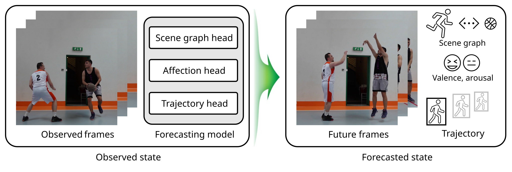
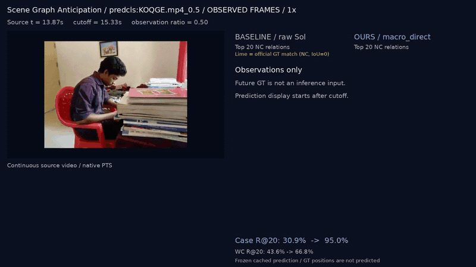
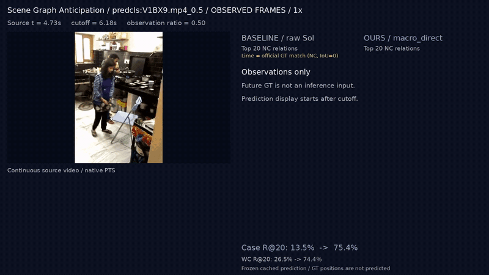
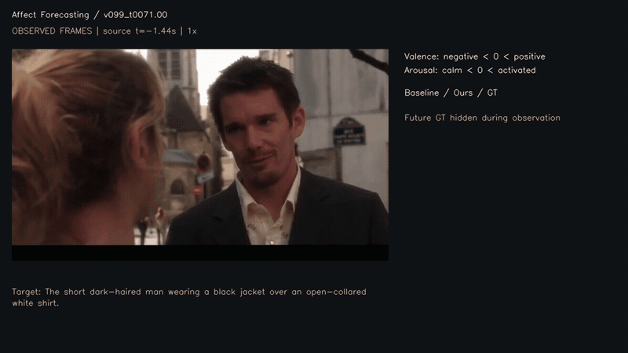
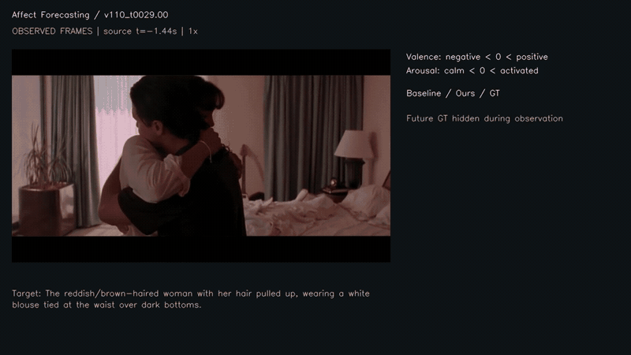
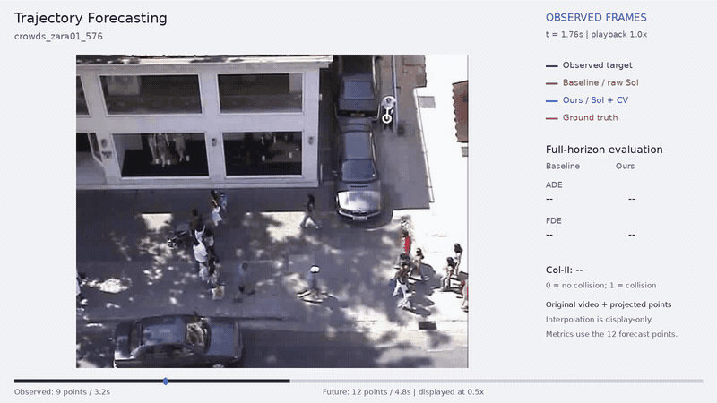
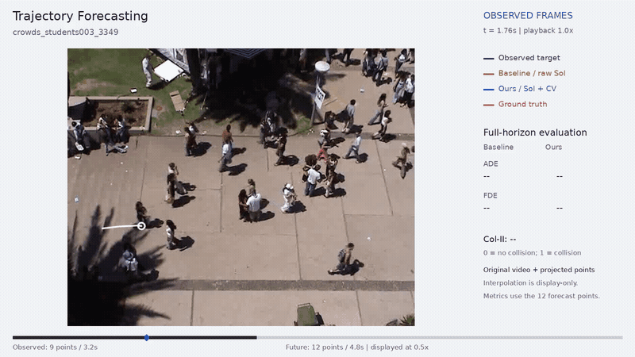
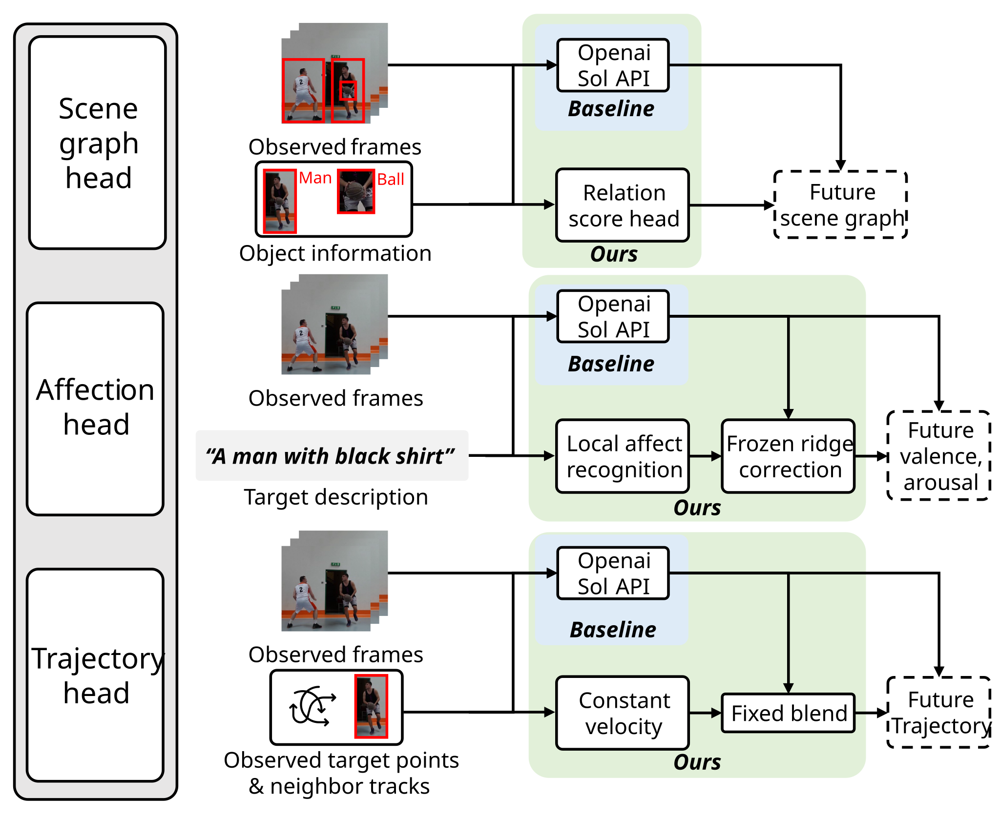
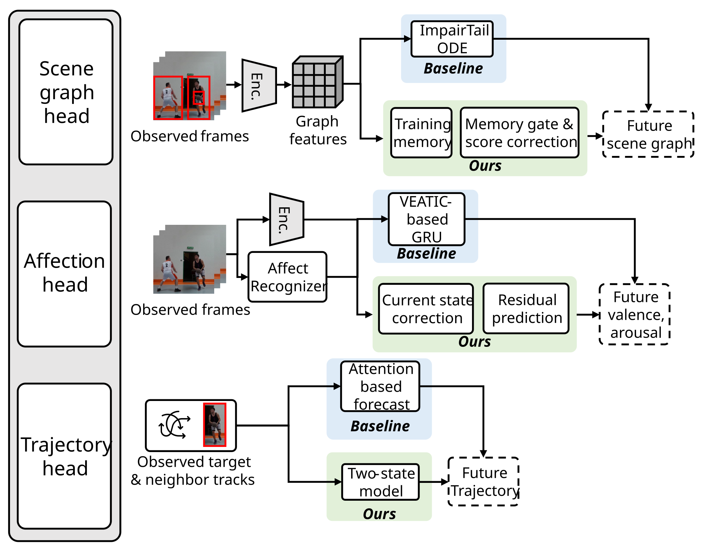

<div align="center">

# Video Forecasting Agent

### 관측에서 예측으로, 예측에서 실제 미래와의 비교로

**Scene Graph Anticipation · Affection Forecasting · Trajectory Forecasting**

CJ 4DPLEX AI 개발 과제 · Track 1: Motion Prediction Agent

[](https://hwp97.github.io/Video_agent_CJ4DPLEX/)
[](TECHNICAL_REPORT.pdf)
[](SYSTEM_ARCHITECTURE.pdf)
[](EXECUTIVE_SUMMARY.pdf)


[Demo](#demo) · [Installation](#installation) · [Quick Start](#quick-start) · [Usage](#usage) · [Results](#results) · [Documentation](#documentation)

</div>

---

## Overview

영상에서 관측한 정보를 이용해 **사람과 물체의 관계**, **인물의 감정 상태**, **보행자의 미래 위치**를 예측하고 실제 이후 장면과 비교합니다. API 기반 방법과 로컬 모델을 각각 같은 계열의 Baseline과 비교하며, 정량 평가와 실제 영상 Demo를 함께 제공합니다.

- **두 실행 경로:** 저장된 Sol 응답을 활용하는 API 재현과 동결 모델의 로컬 추론.
- **세 가지 예측:** 미래 관계 점수, Valence/Arousal, 대상과 이웃의 보행 궤적.
- **확인 가능한 결과:** 최종 API Demo 15개를 GIF로 제공하며, README에는 작업별 2개씩 미리보기를 표시합니다.
- **일관된 경계:** 미래 GT는 학습 감독·평가에 사용하며 동결 추론 입력과 분리합니다.



관측 프레임을 Agent에 입력하면 Scene graph head · Affection head · Trajectory head가 각각 미래 관계 · Valence/Arousal · 좌표를 예측합니다. 현재 구현은 관측 특징·객체 정보·좌표를 사용하는 benchmark 재현 경로입니다. 임의의 새 영상에서 검출·추적·예측을 모두 자동 실행하는 서비스와는 범위를 구분합니다. 자세한 입력 조건은 [System Architecture](docs/SYSTEM_ARCHITECTURE.md)에 설명합니다.

## Demo

최종 선정한 API Demo 15개 중 작업별 앞 2개입니다. GIF는 관측 종료 전 1.5초부터 7.5초를 발췌하며 관측 1배속·미래 0.5배속을 유지합니다. 선정된 15개 사례 ID와 지표는 `assets/final_demo_manifest.json`에 기록되어 있습니다. 전체 15개 GIF와 Local 경로 Demo 15개는 [프로젝트 페이지](https://hwp97.github.io/Video_agent_CJ4DPLEX/)에서 한 번에 볼 수 있습니다.

**Demo 원영상·관측 입력·Sol API 캐시는 Repository에 포함되어 있습니다** — `demo/data/` 아래에 3 head × 선정 15개 사례의 원영상, 프레임, cutoff/horizon, 미래 GT, baseline·Ours 예측이 모여 있고, `demo/data/api_cache/` 에는 같은 15개의 원본 Sol 요청·응답 JSON 이 signature(SHA256) 기반으로 보존되어 있습니다. 평가자는 외부 다운로드·새 API 호출 없이 재현에 필요한 모든 입력을 받을 수 있습니다. 구성은 [`demo/data/README.md`](demo/data/README.md)와 [`demo/data/api_cache/README.md`](demo/data/api_cache/README.md) 를 참고하세요.

API 캐시 → Demo 지표 재검증:

```bash
python tools/api_demo/replay_cache.py                              # 15개 전체
python tools/api_demo/replay_cache.py --task affect_forecasting    # head 단위
python tools/api_demo/replay_cache.py --task affect_forecasting --rank 2  # 사례 단위
```

240k 전수 평가용 모델 가중치·전체 Sol 캐시 같은 대형 자산만 외부 보관 대상이며, 접근은 [Resources](docs/RESOURCES.md)에 안내합니다.

### Scene Graph Anticipation

**API · Raw Sol → 관계 점수 보정**

관측 이후의 관계를 예측하고 공식 평가에서 GT와 일치하는 관계를 연두색으로 표시합니다.

| Demo 04 | Demo 06 |
|---|---|
|  |  |

### Affection Forecasting

**API · Raw Sol → 관측 잔차 보정**

미래 네 시점의 Valence/Arousal과 GT 오차를 비교하며, 확인 가능한 대상 위치에 결과를 표시합니다.

| Demo 02 | Demo 04 |
|---|---|
|  |  |

### Trajectory Forecasting

**API · Raw Sol → Sol + Constant Velocity**

실제 원영상 위에 예측과 정답 궤적을 투영합니다. **파랑은 Ours, 빨강은 GT, 주황은 Baseline**입니다.

| Demo 01 | Demo 02 |
|---|---|
|  |  |

GIF는 사례 설명용입니다. 선정 사례의 지표 차이를 전체 성능으로 일반화하지 않습니다. 원영상의 이용 조건은 GIF에도 그대로 적용됩니다.

## Installation

### 1. 실행 환경

| 항목 | 확인한 환경 |
|---|---|
| OS | Ubuntu20.04.6 LTS |
| Python |3.10.22 |
| 로컬 모델·API 관계/보행 | PyTorch2.5.1+cu118, NumPy1.23.5 |
| API 감정 | 별도 PyTorch2.8.0+cu126 환경 |
| GPU | RTX3090 24GB에서 CUDA 추론·Cosmos 생성 확인 |
| 영상 도구 | FFmpeg · ffprobe · libx264 |

동결 감정 head와 저장 결과 재현은 CPU에서 실행할 수 있습니다. 보행 모델의 전수 동일성 검증은 CUDA에서 수행했습니다. 새 장비의 전체 설치는 별도로 확인해야 하며, 실제 확인한 패키지 버전은 [환경 안내](requirements/README.md)에 제공합니다.

### 2. 설치 방법

두 가지 중 하나를 고릅니다. **Docker 경로는 OS·CUDA·Python 버전 불일치를 피할 수 있어 평가자에게 권장합니다.**

#### 2-A. Docker 경로 (권장)

**Docker Engine 설치** (호스트 OS에 아직 Docker가 없다면):
- Ubuntu/Debian: `curl -fsSL https://get.docker.com | sh` → `sudo usermod -aG docker $USER` → 재로그인
- macOS: Docker Desktop 다운로드 (https://docs.docker.com/desktop/install/mac-install/)
- Windows: Docker Desktop + WSL2 (https://docs.docker.com/desktop/install/windows-install/)
- GPU 사용 시: NVIDIA Container Toolkit 추가 설치 (https://docs.nvidia.com/datacenter/cloud-native/container-toolkit/latest/install-guide.html)

**이미지 빌드·실행:**

```bash
# 이미지 빌드 (약 4~6GB, 10~15분)
docker build -t video-forecasting-agent .

# GPU 추론 (NVIDIA Container Toolkit 필요, 권장)
docker run --rm -it --gpus all \
  -v /path/to/external_data:/data \
  video-forecasting-agent \
  python main.py local affect ours evaluate

# CPU만 사용 (동결 자산 verify·소규모 evaluate 가능, 240k 전수 forward는 CUDA 권장)
docker run --rm -it \
  -v /path/to/external_data:/data \
  video-forecasting-agent
```

`/data`에는 [Resources](docs/RESOURCES.md)에 따라 받은 모델·관측 입력·평가 GT를 마운트하고 `src/{api,local}_based/data/` 아래 심볼릭 링크 또는 복사로 연결합니다. 이미지에 모델 가중치·데이터는 포함되지 않습니다. API 감정 경로의 별도 PyTorch 2.8+cu126 환경은 컨테이너 안에서 `python -m venv .venv_api_affect && .venv_api_affect/bin/pip install -r requirements/b2.txt` 로 추가합니다.

#### 2-B. venv 직접 설치

```bash
sudo apt-get install -y ffmpeg       # 영상 디코딩용 (Ubuntu 기준)
python3.10 -m venv .venv_local
source .venv_local/bin/activate
python -m pip install -r requirements/local.txt
python -m pip install -r requirements/demo.txt   # 영상 렌더링·GIF 재생성 필요 시
```

API 감정 경로는 별도 PyTorch 2.8+cu126 환경을 사용합니다.

```bash
python3.10 -m venv .venv_api_affect
.venv_api_affect/bin/python -m pip install -r requirements/b2.txt

.venv_api_affect/bin/python main.py \
  --python "$PWD/.venv_api_affect/bin/python" \
  api affect ours evaluate
```

API 관계·보행은 기본 로컬 환경과 같은 PyTorch 계열을 사용합니다. API 경로는 저장 응답의 재현이므로 API key 없이 동작하며 누락 응답을 자동으로 재호출하지 않습니다.

### 3. 모델과 데이터 준비

모델·관측 입력·평가 GT는 코드 저장소와 분리합니다. [리소스 안내](docs/RESOURCES.md)의 파일명·경로·SHA에 맞춰 준비합니다.

| 리소스 | 배치 위치 |
|---|---|
| API 요청·응답 캐시, 관측 입력, 평가 GT | `src/api_based/data/` |
| 로컬 동결 모델, 관측 특징·좌표, 평가 GT | `src/local_model_based/data/` |
| 전체 Demo 영상·포스터 (외부 보관) | [Resources](docs/RESOURCES.md) 참조. Repository에는 catalog JSON과 Cosmos 비교 MP4만 포함 |
| README 미리보기 GIF | `assets/readme/` |

**자체 학습 가중치와 원본 Demo MP4·Cosmos 보조 자산은 Repository에 포함되지 않습니다.** 과제원문 2.4 ("용량이 큰 파일은 제출 Repository에 직접 포함하지 않는다")에 따른 조치이며, 다음 두 종류의 자산을 외부 저장소에 보관합니다:

| 자산 | 외부 보관 사유 |
|---|---|
| 자체 학습 동결 가중치, 관측 입력 캐시, 평가 GT | 과제원문 2.4 — 모델 가중치는 Repository 직접 포함 금지. 평가자가 다운로드 가능한 별도 저장 위치 제공 요건. |
| Demo 원본 MP4·포스터 JPG, Cosmos 보조 시각화 자산 | GitHub 권장 리포 용량 초과 (약 600MB). README의 저용량 미리보기 GIF 6개로 사례 확인 가능. |

**평가자용 외부 다운로드 URL은 제출 시점에 확정되지 않았습니다.** 확정 후 [Resources](docs/RESOURCES.md)의 표에 각 자산의 다운로드 경로·SHA256 체크섬을 기재해 README와 함께 전달할 예정입니다. 확정 전에는 작업 서버의 `HWP_CJ4DPLEX_AI_support/submission_cleanup_20261112/` 아래에서 평가자 접근을 수동으로 안내합니다. 공개 모델 원출처와 데이터 이용 조건은 [사용 내역 및 구현 범위](docs/USAGE_AND_SCOPE.md)를 참고해 주세요.

## Quick Start

### 로컬 감정 모델 실행

아래 예시는 기본 환경과 리소스를 준비한 상태에서 C01 Baseline과 D04 Ours를 확인합니다.

실행할 Python 경로는 `--python` 옵션으로 지정합니다. 저장된 개발 장비 경로 대신 준비한 환경을 사용합니다.

```bash
# 모델·입력 범위 확인
python main.py --python "$PWD/.venv_local/bin/python" local affect baseline status
python main.py --python "$PWD/.venv_local/bin/python" local affect ours status

# 한 사례의 미래 VA 예측
python main.py --python "$PWD/.venv_local/bin/python" local affect ours predict \
  --sample-id v003_official_test_t00139.0400

# 같은 집합의 Baseline / Ours 평가
python main.py --python "$PWD/.venv_local/bin/python" local affect baseline evaluate
python main.py --python "$PWD/.venv_local/bin/python" local affect ours evaluate
```

각 명령은 생성한 결과 파일 경로를 출력합니다. 감정 결과는 `results/local_model_based/b2/` 아래에 저장되며 미래 예측은 네 시점×두 축 배열입니다. C01에는 현재 감정 출력 head가 없으므로 현재값 지표는 해당 없음입니다.

## Usage

```text
python main.py [--python PYTHON] {api|local} TASK {baseline|ours} ACTION [OPTIONS]
python main.py [--python PYTHON] demo TASK [OPTIONS]
```

| 인자 | 값 | 의미 |
|---|---|---|
| 실행 계열 | `api` / `local` | API 캐시 기반 / 로컬 모델 기반 |
| `TASK` | `relations` / `affect` / `trajectories` | 관계 / 감정 상태 / 보행 궤적 |
| 방법 | `baseline` / `ours` | 같은 계열의 기준 방법 / 제안 방법 |
| `ACTION` | `status`, `predict`, `replay`, `evaluate`, `verify` | 상태·추론·재현·채점·무결성 검사 |

지원 옵션은 과제별로 다르며 `python main.py --python "$PWD/.venv_local/bin/python" local affect ours --help`처럼 확인할 수 있습니다. `predict`는 지원되는 동결 특징·좌표에서 실제 계산을 수행합니다. `replay`의 저장 출력 사용 여부는 [API 안내](src/api_based/README.md)와 [로컬 안내](src/local_model_based/README.md)에 구분했습니다.

<details>
<summary><strong>관계·보행 실행 예시와 입력 지정</strong></summary>

```bash
# 관측 graph와 prior를 사용하는 로컬 관계 예측
python main.py --python "$PWD/.venv_local/bin/python" local relations ours predict \
  --sample predcls:GF7DV.mp4_0.5

# 보행 모델의 입력과 방법 확인
python main.py --python "$PWD/.venv_local/bin/python" local trajectories ours status

# 준비된 전체 관측 좌표에서 CUDA 추론
python main.py --python "$PWD/.venv_local/bin/python" local trajectories ours predict --device cuda

# API 관계 예측의 캐시 재현
python main.py --python "$PWD/.venv_local/bin/python" api relations ours status
```

관계·감정은 제공된 sample ID를 지정합니다. 보행은 준비된 관측 좌표 manifest를 사용합니다. 임의 MP4를 지정하는 범용 `--video` 인터페이스는 제공하지 않습니다. 결과는 `results/<계열>/<내부 과제 폴더>/`에 새로 저장되며 세부 옵션은 각 실행기의 도움말을 따릅니다.

</details>

<details>
<summary><strong>Demo·GIF 재생성</strong></summary>

`main.py demo`는 API 영상 렌더러를 연결합니다. 확정된 예측·GT와 원영상이 필요합니다.

```bash
export VEATIC_VIDEO_ROOT="/path/to/VEATIC/videos"
python main.py --python "$PWD/.venv_local/bin/python" demo affect
python tools/local_demo/affect.py --render
python tools/final_demo_gifs.py
```

다른 과제의 렌더링 명령은 [API Demo](demo/api_based/README.md)·[Local Demo](demo/local_model_based/README.md)를 따릅니다. GIF의 원본·발췌 구간·해상도·해시는 [미리보기 manifest](assets/readme/manifest.json)에 기록합니다.

</details>

## Methods & Results

| 과제 | API: Baseline → Ours | Local: Baseline → Ours |
|---|---|---|
| 관계 예측 | Raw Sol → macro_direct | ImparTail ODE → 메모리 gate·관계 보정 |
| 감정 상태 예측 | Raw Sol → 관측 잔차 Ridge | C01 GRU → D04 현재 보정·미래 변화량 |
| 보행 궤적 예측 | Raw Sol →0.75 Sol +0.25 CV | Attention → F 두 상태 반복 D04 |

| API 계열 구조 | Local 계열 구조 |
|---|---|
|  |  |

### Results

아래는 최신 로컬 모델의 **동일 평가집합 안에서의 비교**입니다. API 결과·추가 비교군·다른 지표와 평가 프로토콜 전체는 [Technical Report](docs/TECHNICAL_REPORT.md) 4·9장을 참조하세요.

| 평가 조건 | 지표 | Baseline | Ours |
|---|---|---:|---:|
| 관계 SGCLS · 관측50% · NC | R20 / mR20 ↑ |0.480268 / 0.336508|0.491097 / 0.418568|
| 관계 PredCls · 관측50% · NC | R20 / mR20 ↑ |0.633108 / 0.423031|0.666159 / 0.490949|
| 감정 · official_test438 | MAE ↓ / CCC ↑ |0.221696 / 0.565830|0.218839 / 0.577387|
| 보행 ·240,890장면 | ADE ↓ / FDE ↓ |1.052211 / 2.170546|1.058973 / 2.157528|
| 보행 · 동일 집합 | 관측 이웃 충돌률% ↓ |22.046162|22.154095|

감정 D04는 C01보다 두 지표가 좋지만 기존 GRU보다 우수하지 않습니다. 보행은 FDE가 줄고 ADE·충돌률은 악화했습니다. 반복 열람한 평가 영역이며 보행은 공개 v4 train의 사용자 정의 그룹 교차검증입니다. 선택 기준·성능 상충·실패 분석은 [Technical Report](docs/TECHNICAL_REPORT.md)에 공개합니다.

## Reproducibility

```bash
# 동결 자산과 원 예측 대조
python main.py --python "$PWD/.venv_local/bin/python" local affect baseline verify
python main.py --python "$PWD/.venv_local/bin/python" local affect ours verify

# 실행 경계와 모델 회귀 검사
python -B -m pytest -q -p no:cacheprovider \
  src/local_model_based/tests src/api_based/tests/test_runtime.py
```

관측 전용 추론과 평가 GT 접근을 분리하고, 동결 자산 SHA·원 예측 일치·영상 디코딩을 확인합니다. 재학습 없이 제공된 checkpoint를 사용하며 새 API 호출은 수행하지 않습니다.

## Project Structure

```text
.
├── README.md                 # 본 문서
├── index.html                # 프로젝트 페이지 (GitHub Pages에서 자동 서빙)
├── Dockerfile                # 재현용 컨테이너 (PyTorch 2.5.1 + CUDA 11.8 + ffmpeg)
├── main.py                   # API / Local / Demo 진입점
├── *.pdf                     # 제출 산출물 4종 PDF
├── src/
│   ├── api_based/            # 저장 API 응답 기반 추론·평가
│   └── local_model_based/    # 동결 로컬 모델·평가·학습 소스
├── requirements/             # 실행 계열별 의존성
├── assets/
│   ├── readme/               # README Figure·미리보기 GIF 6개
│   └── demos/                # 프로젝트 페이지용 전체 길이 GIF 15개
├── demo/                     # 과제별 catalog·평가·예측 metadata (원본 MP4는 외부 보관)
├── results/                  # 실행 결과와 평가 기록 (.gitignore)
├── tools/                    # 영상 렌더링·GIF·문서 빌드 도구
└── docs/                     # 제출 산출물 MD와 Resources
```

## Documentation

| 문서 | 내용 |
|---|---|
| [System Architecture](SYSTEM_ARCHITECTURE.pdf) · [원문 MD](docs/SYSTEM_ARCHITECTURE.md) | 입력·모델·도구 연계와 구현 경계 |
| [Technical Report](TECHNICAL_REPORT.pdf) · [원문 MD](docs/TECHNICAL_REPORT.md) | 데이터·방법·실험·실패 분석·한계 |
| [Executive Summary](EXECUTIVE_SUMMARY.pdf) · [원문 MD](docs/EXECUTIVE_SUMMARY.md) | 문제·접근·핵심 결과를 정리한 2쪽 요약 |
| [사용 내역 및 구현 범위](USAGE_AND_SCOPE.pdf) · [원문 MD](docs/USAGE_AND_SCOPE.md) | 데이터·모델·OSS·AI 도구와 직접 구현 범위 |
| [Resources](docs/RESOURCES.md) | 가중치·관측 입력·GT의 준비 경로와 무결성 정보 |

## Acknowledgements & Usage

이 프로젝트는 [ImparTail](https://github.com/rohithpeddi/ImparTail), [SceneSayer](https://github.com/rohithpeddi/SceneSayer), [VEATIC](https://github.com/AlbusPeter/VEATIC), [TrajNet++](https://github.com/vita-epfl/trajnetplusplusdata), [Cosmos-Predict2.5](https://github.com/nvidia-cosmos/cosmos-predict2.5)와 공개 데이터·평가 구현을 활용합니다.

데이터·영상·모델·코드는 각 원출처의 이용 조건을 따릅니다. GIF 변환이 영상의 재배포 권한을 새로 부여하지 않으며, 제출·공개 범위와 자체 모델의 외부 제공 위치는 [사용 내역 및 구현 범위](docs/USAGE_AND_SCOPE.md)와 [Resources](docs/RESOURCES.md)에 구분했습니다.
