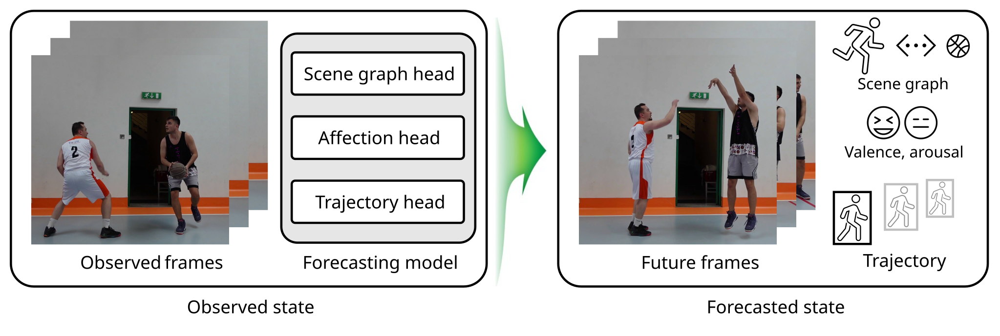
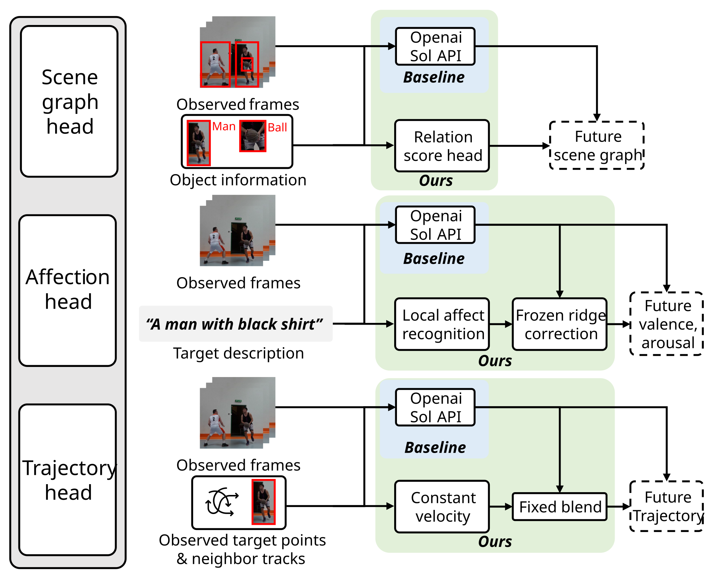
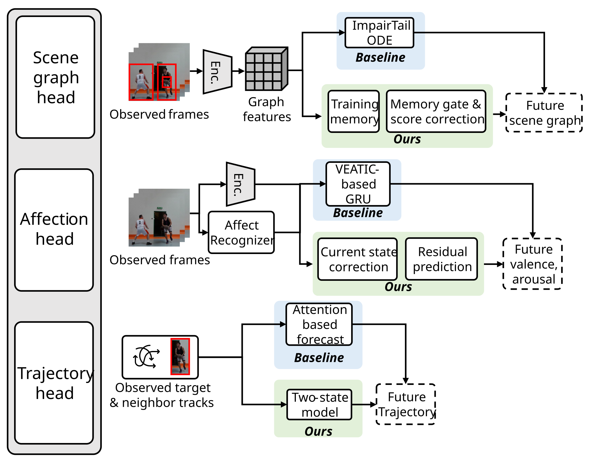

# System Architecture

## 목적과 구현 경계

Track 1의 영상 미래 예측을 세 가지 head로 나눈다. **Scene graph head**는 관측 이후 사람·물체 관계를 예측하고, **Affection head**는 관측한 인물의 Valence/Arousal 변화를 예측하며, **Trajectory head**는 보행 대상의 미래 좌표를 예측한다. API 기반 시스템은 관측 입력을 구조화해 저장한 Sol 응답을 재현하며, 동일 응답에 작은 보정을 적용한 결과를 baseline과 비교한다. 로컬 모델 기반 시스템은 외부 추론 API 없이 동결 체크포인트로 같은 입력을 처리한다. 현재 실행 경로는 오프라인 캐시 재현이며, 임의의 새 영상에서 검출·추적·API 수집까지 자동 실행하는 범용 서비스는 범위에 포함되지 않는다.

## Agent 전체 구성

Agent는 관측 프레임(Observed frames)을 입력받아 세 개의 head가 병렬 동작하는 Forecasting model을 거쳐 Future frames에 해당하는 미래 Scene graph, Valence/Arousal, Trajectory를 출력한다. 각 head의 출력은 기존 평가 프로토콜의 정답과 비교하고 원본 영상 위에 시각화한다.

## API 기반 Agent 구성

세 head 모두 공통적으로 관측 프레임과 대상 설명을 Sol API에 전달해 미래 예측을 받는다. Baseline은 Sol의 응답을 그대로 사용한다.

- Scene graph head Ours: Sol의 관계 예측과 관측 문맥을 Relation score head에 함께 넣어 미래 scene graph를 보정한다.
- Affection head Ours: Local affect recognition으로 얻은 관측 VA와 Sol 예측을 Frozen Ridge correction에 결합해 미래 Valence/Arousal을 보정한다.
- Trajectory head Ours: Sol 궤적과 관측 이웃 Constant velocity 추정을 0.75 : 0.25 Fixed blend로 결합한다.

API 경로는 저장된 응답의 재현이며 제출 시점에는 새 API 호출을 수행하지 않는다. 누락 응답을 자동 재호출하지 않고 전체 요청 분모와 함께 보고한다.

## Local 모델 기반 Agent 구성

Local 경로는 외부 추론 API 없이 동결 체크포인트로 전체 과정을 실행한다.

- Scene graph head: Baseline은 ImparTail ODE. Ours는 Training memory와 Memory gate · Score correction을 결합해 관측 문맥 기반 관계 점수를 보정한다.
- Affection head: Baseline은 VEATIC-based GRU. Ours는 Current state correction과 Residual prediction을 분리해 관측 현재값 보정과 미래 변화량을 각각 계산한다.
- Trajectory head: Baseline은 Attention based forecast. Ours는 Two-state model이 Motion feature와 Neighbor mask를 반복 갱신해 미래 좌표를 생성한다.

학습한 모델 가중치는 저장소에 직접 포함하지 않고 별도 저장 위치에서 다운로드한다. 준비 경로와 무결성 정보는 [Resources](RESOURCES.md)에 기록한다.

## 구성요소와 입출력

| 구성요소 | 입력 | 출력 및 역할 | 코드 |
|---|---|---|---|
| 공통 실행기 | 계열, head, baseline/ours, 명령 | 호환 환경 선택·비밀 환경 변수 제거·출력 분리 | `main.py`, `src/api_based/main.py`, `src/local_model_based/main.py` |
| 실행 경계 | 각 head 실행 경로 | 네트워크·다른 계열 접근 제한 | `src/*/runtime_guard.py` |
| Scene graph head | 관측 객체/관계 또는 관측 graph, Sol 관계 순위 | 미래 프레임별 26관계 점수 | `src/*/baseline/b1/`, `src/*/ours/b1/` |
| Affection head | 관측 프레임 또는 관측 VA 특징, Sol 현재/미래 VA | +0.5/+1/+2/+3초의 Valence·Arousal | `src/*/baseline/b2/`, `src/*/ours/b2/` |
| Trajectory head | 대상·이웃 관측 9시점, Sol 미래 좌표 | 0.4초 간격 미래 12개 2D 좌표 | `src/*/baseline/b3/`, `src/*/ours/b3/` |
| 평가 | 저장 예측·같은 사례 GT | R/mR, MAE/CCC, ADE/FDE/Col-II | 각 head `evaluate` |
| 데모 | 확정 예측·시각/좌표·평가 GT | 관측/미래 구분과 baseline/ours/GT 영상 | `tools/api_demo/`, `tools/local_demo/`, `demo/` |

내부 식별자는 b1 = Scene graph head, b2 = Affection head, b3 = Trajectory head다. 폴더·CLI 슬러그는 과거 호환성을 위해 `relations`·`affect`·`trajectories`로 유지한다.

## 설계 결정

1. 같은 Sol 응답을 baseline과 Ours가 공유한다. 모델의 무작위성·수집 시점 변화와 후처리 효과를 분리하기 위해서다.
2. Scene graph는 동결 선형 보정, Affection은 동결 Ridge, Trajectory는 고정 비율 혼합을 사용한다. 제출 단계에서 다시 학습하거나 평가 집합으로 비율을 조정하지 않는다.
3. 예측과 평가를 분리한다. 미래 영상·GT는 평가와 렌더링 단계에만 연결한다. GT가 들어간 시각화에서 다시 예측을 계산하지 않는다.
4. 실패 응답은 자동 재호출·임의 대체하지 않는다. 누락·대상 기권을 전체 요청 분모와 함께 보고한다.
5. 두 경로(API·Local)의 평가집합·cutoff가 다르므로 두 경로 수치를 직접 비교하지 않는다. 각 경로 내부의 same-set baseline/Ours 비교로 해석한다.

## 남은 구조적 한계

Scene graph head는 미래 annotation schedule을 알고 있고 IoU=0 조건으로 평가한다. Affection head는 이미 산출한 관측 로컬 인식 특징을 재사용한다. Trajectory head는 원영상에서 좌표를 추출하는 연결이 없다. 따라서 이 제출본은 각 head의 benchmark 기반 Agent 구성과 검증을 재현하며, 과제원문 3.3의 임의 영상 전체 실행을 모두 충족했다고 주장하지 않는다. 새 영상 경로에는 관측 전용 검출·추적·대상 식별·카메라 보정과 승인된 API 수집이 추가로 필요하다.
